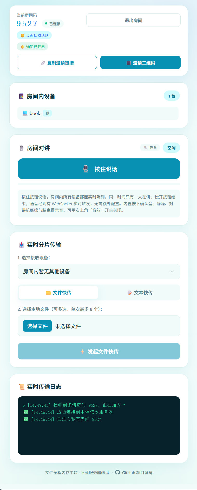

<div align="center">



# PipeShare

**基于 WebSocket 分片传输的零无感快传工具**

不占服务器磁盘 · 文件与文本秒级跨端互传 · 私有房间隔离

[](https://nodejs.org) [](https://github.com/zxecsm/pipeshare/pkgs/container/pipeshare) [](#-安装为独立应用) [](./package.json)

[快速开始](#-快速开始) · [功能特性](#-功能特性) · [使用说明](#-使用说明) · [部署](#-部署) · [稳定性](#-稳定性设计) · [本地开发](#-本地开发) · [说明](#-说明)

</div>

---

**PipeShare** 把文件和文本从一台设备秒传到另一台设备：文件切成小片经 WebSocket 中转，服务器只在内存中转发、不落盘，接收端确认一片才发下一片，链路稳定、可背压，不依赖两条 HTTP 流对接。

同时支持 **私有房间**：不同房间完全隔离，只有进入同一房间的设备才能互相发现和传输；房间可通过 **邀请链接 / 二维码** 一键分享。

## 🚀 快速开始

**Docker（推荐）**

```bash
docker compose up -d
docker compose logs -f   # 启动日志会打印所有可访问地址
```

**或者直接运行**

```bash
docker run -d --name pipeshare --restart unless-stopped \
  -p 3000:3000 -e TZ=Asia/Shanghai \
  ghcr.io/zxecsm/pipeshare:latest
```

打开 `http://服务器地址:3000`，填写昵称后创建房间即可开传。

> [!TIP]
> 启动日志会列出本机所有可访问地址（`localhost`、局域网 IPv4 / IPv6、Tailscale 等），不确定用哪个地址时看一眼日志即可。

## ✨ 功能特性

| 能力                   | 说明                                                                                                                                     |
| ---------------------- | ---------------------------------------------------------------------------------------------------------------------------------------- |
| 🔒 **私有房间隔离**    | 每台设备先创建或加入房间，设备列表、文本、文件只在房间内可见可传                                                                         |
| 🔳 **二维码邀请**      | 房间内点击「邀请二维码」，手机扫码即可直接进入，无需手输房间码                                                                           |
| 🔗 **邀请链接**        | `https://你的域名/?room=房间码`，打开即自动加入                                                                                          |
| ⚡ **WebSocket 分片**  | 文件切成 512KB 分片经 WebSocket 中转，接收端确认后再发下一片，稳定且可背压                                                               |
| 💾 **临时文件接收**    | 优先用 OPFS（`navigator.storage.getDirectory`）分片落盘，全部到齐后合并下载并清理；浏览器不支持时自动退回内存                     |
| ♻️ **断点续传**        | 发送端采样计算文件指纹，接收端按指纹定位未完成的临时分片，重发同一文件时从断点继续，不重复传输已收部分                                   |
| 📝 **文本快传**        | 文本 / 网址通过 WebSocket 信令直达，一键复制；发送端也可直接读取剪贴板一键发送                                                           |
| 📦 **多文件批量**      | 一次可选择多个文件，接收方只需确认一次，桌面端和移动端都有独立进度卡片                                                                   |
| ☀️ **保持页面活跃**    | 进入房间自动请求屏幕常亮（Wake Lock），传输中刷新 / 关闭页面会二次确认                                                                   |
| 🔔 **系统通知**        | 页面不在前台时，收到文本或文件邀请会弹出系统通知，点击即聚焦或打开页面                                                                   |
| 📲 **可安装为应用**    | 支持 PWA，安装后从桌面 / 主屏幕直接打开，拥有独立窗口和离线外壳                                                                          |
| 🧭 **断线自动重连**    | Socket.IO 自动重连并重新加入原房间                                                                                                       |
| 🛡 **传输容错**        | 邀请超时、分片顺序校验、字节数校验、任一端断线都会统一清理任务并通知双方                                                                 |
| 🚦 **并发安全**        | 每个传输任务独立令牌，支持同时进行多个传输，互不串包                                                                                     |

## 📖 使用说明

1. 打开页面，填写昵称，点击「创建私有房间」，会得到一个 6 位房间码。
2. 点击「邀请二维码」或「复制邀请链接」发给好友；对方扫码 / 打开链接会自动进入同一个房间。
3. 房间内所有设备都会出现在「房间内设备」列表中，选择目标设备后即可发送文件或文本。
4. 接收方确认后，文件按 512KB 分片经 WebSocket 传输；接收方每接收一片才确认一次，发送方据此滑动窗口，双方都能看到进度。
5. 文件按分片写入浏览器的 OPFS 临时目录（不支持时退回内存），全部到齐后自动合并下载并清理临时文件；中断后重新发送同一个文件，接收端会从已收到的位置断点续传。
6. 点击「退出房间」离开；房间空置 30 分钟后自动回收。

> [!WARNING]
> 房间码就是进入房间的唯一凭证，请只分享给可信的人。任何人拿到链接或房间码都可以加入房间。

### 🔔 系统通知

- 首次创建 / 加入房间时浏览器会请求通知权限，也可以之后点击房间顶部的「🔔 开启通知」。
- 收到文本或文件邀请时，如果页面当前不在前台（切到其他标签页、最小化或窗口失焦），会调用系统通知；页面正被查看时只显示页面内弹窗，不重复打扰。
- 点击通知会关闭它，并聚焦已打开的页面，页面未打开时则打开通知里的房间地址。
- 系统通知需要 **HTTPS 或 localhost**。iOS 需要先「添加到主屏幕」，并在系统设置中允许通知（iOS 16.4+）。
- 通知由页面收到 Socket.IO 消息时本地触发，不是服务端 Web Push；浏览器 / 应用完全关闭后不会收到通知。

## 🚀 部署

### 🐳 Docker Compose

仓库根目录自带 [`docker-compose.yml`](./docker-compose.yml)，端口、时区、环境变量都有注释说明：

```yaml
services:
  pipeshare:
    image: 'ghcr.io/zxecsm/pipeshare:latest'
    container_name: pipeshare
    restart: unless-stopped
    ports:
      - '3000:3000'
    environment:
      - TZ=Asia/Shanghai
      - PORT=3000
      - HOST=0.0.0.0
      # - TRUST_PROXY=1
```

```bash
docker compose up -d       # 启动
docker compose logs -f     # 查看日志（含所有可访问地址）
docker compose down        # 停止
```

健康检查：`GET /healthz`，返回在线设备数、房间数、进行中的传输数。

### 📦 独立可执行文件（免安装 Node.js）

项目使用 [@yao-pkg/pkg](https://github.com/yao-pkg/pkg) 打包成单文件可执行程序，目标机器不需要安装 Node.js，`public/` 静态资源也会一并打进文件。

```bash
npm install                 # 首次打包需要安装依赖

npm run build:win           # dist/pipeshare-win-x64.exe
npm run build:linux         # dist/pipeshare-linux-x64
npm run build:linux-arm64   # dist/pipeshare-linux-arm64（树莓派等 ARM64）
npm run build:macos         # dist/pipeshare-macos-x64
npm run build:macos-arm64   # dist/pipeshare-macos-arm64（Apple Silicon）

npm run build               # 一次打包以上全部平台
```

也可以只打包当前平台，例如 `npx pkg . -t node22-win-x64`。首次打包会下载对应平台的 Node 基础二进制并缓存在 `~/.pkg-cache`，之后可离线复用；产物是单文件，直接拷到同架构机器即可运行。

```bash
./pipeshare-win-x64.exe     # Windows（也可以直接双击）
./pipeshare-linux-x64       # Linux / NAS / 软路由
./pipeshare-macos-arm64     # macOS
```

| 提示             | 说明                                                                                   |
| ---------------- | -------------------------------------------------------------------------------------- |
| 🪟 **Windows**   | 双击 exe 会打开控制台窗口并常驻显示访问地址，关闭窗口即停止服务                        |
| 🧱 **防火墙**    | 首次运行可能被系统防火墙拦截，允许后同一局域网的手机 / 电脑才能访问                    |
| 🗂 **配置文件**  | 读取 **exe 同目录** 的 `.env`（与双击时的当前目录无关），把 `.env.example` 复制过去即可 |
| 🔐 **HTTPS**     | 需要域名 / HTTPS 时，把 exe 跑在 Nginx、Caddy 等反向代理后面，见下一节                  |

```ini
# .env（放在可执行文件旁边）
PORT=3000
HOST=0.0.0.0
# TRUST_PROXY=1
```

没有 `.env` 时使用默认值 `0.0.0.0:3000`；已存在的系统环境变量优先于文件内容。

### ⚙️ 环境变量

| 变量          | 默认值    | 说明                                                        |
| ------------- | --------- | ----------------------------------------------------------- |
| `PORT`        | `3000`    | 监听端口                                                    |
| `HOST`        | `0.0.0.0` | 监听地址                                                    |
| `TRUST_PROXY` | 空        | 位于 Nginx / Caddy 等反向代理后设为 `1`，限流按真实 IP 计算 |

除了 Docker 的 `environment`，也可以用 `.env` 文件配置（三个变量同样适用）：可执行文件读取 **自身所在目录** 的 `.env`，源码运行（`npm start`）读取项目根目录的 `.env`。已存在的系统环境变量优先级更高，不会被 `.env` 覆盖；模板见 [`.env.example`](./.env.example)。

### 🌐 Nginx 反向代理

文件走 WebSocket，只需要保证升级头和足够的读超时：

```nginx
location / {
    proxy_pass http://127.0.0.1:3000;
    proxy_http_version 1.1;

    proxy_set_header Host $host;
    proxy_set_header X-Real-IP $remote_addr;
    proxy_set_header X-Forwarded-For $proxy_add_x_forwarded_for;
    proxy_set_header X-Forwarded-Proto $scheme;

    # WebSocket 升级（Socket.IO）
    proxy_set_header Upgrade $http_upgrade;
    proxy_set_header Connection "upgrade";

    # 分片持续流动，正常不会触发空闲超时；调大兜底，避免慢速链路被提前切断
    proxy_read_timeout 3600s;
    proxy_send_timeout 3600s;
}
```

## 📲 安装为独立应用

项目内置 PWA 支持（`manifest.webmanifest` + `sw.js` + 多尺寸图标），安装后以独立窗口运行，不再显示浏览器地址栏。

| 平台                 | 安装方式                                                             |
| -------------------- | -------------------------------------------------------------------- |
| Chrome / Edge 桌面端 | 地址栏右侧「安装」图标，或菜单 →「安装 PipeShare / 安装应用」        |
| Android Chrome       | 菜单 →「安装应用 / 添加到主屏幕」；页面内也会出现「📲 安装应用」入口 |
| iOS Safari           | 分享按钮 →「添加到主屏幕」；页面内「安装应用」会给出图文步骤         |

**安装条件**

- 必须通过 **HTTPS 或 localhost** 访问。HTTP 局域网地址无法注册 Service Worker，因此不能安装，也无法使用屏幕常亮。
- 页面内会出现「📲 安装为独立应用」按钮（浏览器触发安装提示，或 iOS 设备上直接显示）。

**离线能力**

- Service Worker 只缓存应用外壳（HTML、图标、Socket.IO 客户端脚本等），离线时仍能打开界面。
- `/api/*`、`/healthz` 和 Socket.IO 实时连接 **不会进入缓存**，文件传输仍然需要网络。
- 更新静态资源时请同步修改 `public/sw.js` 里的 `CACHE_NAME`，让旧缓存被清理。

## 🧩 稳定性设计

| 场景                    | 处理方式                                                               |
| ----------------------- | ---------------------------------------------------------------------- |
| 接收方长时间不确认      | 邀请 2 分钟过期，双方都会收到提示，任务自动释放                        |
| 传输通道卡死            | 60 秒没有任何分片或 ack 流动即主动中断，避免任务永久悬挂               |
| 发送端 / 接收端断网     | 立即终止相关任务并通知存活的一方，发送端分片窗口随之停止               |
| 接收方取消              | 停止发送端分片窗口，回收任务与定时器                                   |
| 网络抖动 / 服务重启     | 客户端自动重连并重新加入原房间，传输任务会明确提示中断                 |
| 同时发送多个文件        | 以 `clientTaskId` 精确绑定本地文件；接收端逐个启动，不会串包或传错文件 |
| 分片乱序 / 超量         | 服务端校验序号与累计字节数，异常立即中断，不会拼出坏文件               |
| 大文件内存占用          | 分片窗口限制在途数据；接收端写入 OPFS 临时分片，完成后合并下载         |
| 暴力猜房间码 / 批量建房 | 按 IP 做分钟级限流，避免房间资源被刷爆                                 |
| 设备自动休眠 / 误关页面 | 支持时自动启用屏幕常亮；传输中刷新或关闭页面会弹二次确认               |

**默认限制**（可在 `server.js` 顶部常量调整）

| 项目           | 默认值           |
| -------------- | ---------------- |
| 单房间设备数   | 32               |
| 服务器房间总数 | 1000             |
| 邀请等待时间   | 2 分钟           |
| 通道卡死判定   | 60 秒无数据      |
| 空房间保留     | 30 分钟          |
| 单条文本大小   | 256 KB           |
| 单次批量文件数 | 8 个             |
| 单设备并发传输 | 12 个            |
| 分片大小       | 512 KB           |
| 在途分片窗口   | 16 片（约 8 MB） |

## 🛠 本地开发

要求 Node.js 18+（推荐 20 / 22 / 24）。项目使用 ES Module（`package.json` 中 `"type": "module"`），服务端、测试和浏览器端统一通过 `import` 引入模块。

```bash
npm install
cp .env.example .env   # 可选：本地覆盖 PORT / HOST / TRUST_PROXY

npm start              # 生产模式
npm run dev            # 修改文件自动重启
npm test               # 端到端冒烟测试
```

`npm test` 覆盖：房间隔离、文本快传、单文件、多文件并发、中途取消、字节数校验、二维码、PWA 资源。

## 📌 说明

- 文件分片经服务器内存转发，不落服务器磁盘；单条连接在途数据被窗口限制在约 8MB，不会因为文件变大而线性占用服务器内存。
- 接收端优先通过 `navigator.storage.getDirectory()`（OPFS）把分片写入浏览器临时目录，全部到齐后用这些磁盘分片组成 Blob 并自动触发下载；Blob 只持有分片引用，下载时由浏览器从磁盘流式读取，**不会把整个文件读进 JS 内存**。浏览器不支持 OPFS 时退回内存接收。中断后重新发送同一个文件，接收端会按文件指纹找到未完成的分片，从断点继续接收。
- 临时分片默认保留 24 小时以便续传，成功下载后 10 分钟自动清理；可在浏览器站点数据中手动清除。
- 读取发送端剪贴板依赖 `navigator.clipboard.readText()`，需要 **HTTPS 或 localhost** 并允许剪贴板权限；不支持时可手动粘贴到输入框发送。
- 批量接收多个文件时，浏览器可能提示「允许下载多个文件」，选择允许即可；若没有自动开始，可点击日志中的手动保存链接。
- 屏幕常亮依赖浏览器的 Wake Lock API，仅在 **HTTPS 或 localhost** 下生效；HTTP 局域网访问时页面会显示「常亮不可用」，请保持页面在前台。
- 房间、在线状态和传输任务保存在内存中，服务重启后需要重新创建房间（旧邀请链接会提示房间不存在）。
- 项目自身不做账号体系，房间码 / 二维码即凭证，请部署在可信网络或自行加一层访问控制。
- 若使用 CDN，请确保支持并正确转发 WebSocket（`Upgrade` / `Connection` 头）。

---

<div align="center">

如果 PipeShare 对你有帮助，欢迎点个 ⭐ Star

</div>
