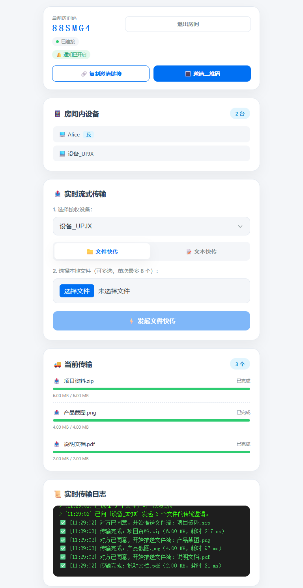

# pipeshare

基于 Web 管道流技术的零无感快传工具，不占服务器磁盘，文件、文本秒级跨端互传。



现在支持 **私有房间**：不同房间之间完全隔离，只有进入同一房间的设备才能互相发现和传输文件；房间可通过 **邀请链接 / 二维码** 一键分享。

## ✨ 功能特性

- 🔒 **私有房间隔离**：每台设备先创建或加入房间，设备列表、文本、文件只在房间内可见可传
- 🔳 **二维码邀请**：房间内点击「邀请二维码」即可让手机扫码直接进入，无需手输房间码
- 🔗 **邀请链接**：`https://你的域名/?room=房间码`，打开即自动加入
- ⚡ **零磁盘中转**：文件从发送端请求流直接管道到接收端响应流，服务器不落盘
- 📝 **文本快传**：文本 / 网址通过 WebSocket 信令直达，收到后可一键复制
- 📦 **多文件批量**：一次可选择多个文件，接收方只需确认一次；批量文件在桌面端和移动端都有独立进度卡片
- ☀️ **保持页面活跃**：进入房间自动请求屏幕常亮（Wake Lock），传输中刷新/关闭页面会二次确认
- 🔔 **系统通知**：页面不在前台时，收到文本或文件邀请会弹出系统通知；点击通知会关闭它，并聚焦或打开当前页面
- 📲 **可安装为独立应用**：支持 PWA，安装后从桌面/主屏幕直接打开，拥有独立窗口和离线外壳
- 🧭 **断线自动重连**：Socket.IO 自动重连并重新加入原房间
- 🛡 **传输容错**：邀请超时、卡死检测、任一端断线、浏览器取消下载都会统一清理任务并通知双方
- 🚦 **并发安全**：每个传输任务独立令牌，支持同时进行多个传输，互不串包

## 🚀 部署

```yaml
services:
  pipeshare:
    image: 'ghcr.io/zxecsm/pipeshare:latest'
    container_name: pipeshare
    restart: unless-stopped
    ports:
      - '3000:3000'
    environment:
      - TZ=Asia/Shanghai
```

```bash
docker run -d \
  --name pipeshare \
  --restart unless-stopped \
  -p 3000:3000 \
  ghcr.io/zxecsm/pipeshare:latest
```

启动后访问 `http://服务器地址:3000`，输入昵称后创建房间即可。

### 环境变量

| 变量          | 默认值    | 说明                                                        |
| ------------- | --------- | ----------------------------------------------------------- |
| `PORT`        | `3000`    | 监听端口                                                    |
| `HOST`        | `0.0.0.0` | 监听地址                                                    |
| `TRUST_PROXY` | 空        | 位于 Nginx / Caddy 等反向代理后设为 `1`，限流按真实 IP 计算 |

健康检查：`GET /healthz`，返回在线设备数、房间数、进行中的传输数。

### Nginx 反向代理

流式转发必须关闭缓冲，并放宽超时，否则大文件会被代理提前切断：

```nginx
location / {
    proxy_pass http://127.0.0.1:3000;
    proxy_http_version 1.1;

    proxy_set_header Host $host;
    proxy_set_header X-Real-IP $remote_addr;
    proxy_set_header X-Forwarded-For $proxy_add_x_forwarded_for;
    proxy_set_header X-Forwarded-Proto $scheme;

    # WebSocket 升级（Socket.IO）
    proxy_set_header Upgrade $http_upgrade;
    proxy_set_header Connection "upgrade";

    # 关闭请求和响应缓冲区，开启真正的公网流式中转
    proxy_buffering off;
    proxy_request_buffering off;

    # 大文件上传不受限制，长传输不被超时中断
    client_max_body_size 0;
    proxy_read_timeout 3600s;
    proxy_send_timeout 3600s;
}
```

## 📖 使用说明

1. 打开页面，填写昵称，点击「创建私有房间」，会得到一个 6 位房间码。
2. 点击「邀请二维码」或「复制邀请链接」发给好友；对方扫码 / 打开链接会自动进入同一个房间。
3. 房间内所有设备都会出现在「房间内设备」列表中，选择目标设备后即可发送文件或文本。
4. 接收方确认后开始流式下载，发送方实时推送，双方都能看到进度。
5. 点击「退出房间」离开；房间空置 30 分钟后自动回收。

> 房间码就是进入房间的唯一凭证，请只分享给可信的人。任何人拿到链接或房间码都可以加入房间。

### 🔔 系统通知

- 首次创建/加入房间时浏览器会请求通知权限，也可以之后点击房间顶部的「🔔 开启通知」。
- 收到文本或文件邀请时，如果页面当前不在前台（切到其他标签页、最小化或窗口失焦），会调用系统通知；页面正被查看时只显示页面内弹窗，不重复打扰。
- 点击通知会关闭它，并聚焦已打开的页面，页面未打开时则打开通知里的房间地址。
- 系统通知需要 **HTTPS 或 localhost**。iOS 需要先「添加到主屏幕」，并在系统设置中允许通知（iOS 16.4+）。
- 通知由页面收到 Socket.IO 消息时本地触发，不是服务端 Web Push；浏览器/应用完全关闭后不会收到通知。

## 📲 安装为独立应用

项目内置了 PWA 支持（`manifest.webmanifest` + `sw.js` + 多尺寸图标），安装后会以独立窗口运行，不再显示浏览器地址栏。

| 平台                 | 安装方式                                                             |
| -------------------- | -------------------------------------------------------------------- |
| Chrome / Edge 桌面端 | 地址栏右侧「安装」图标，或菜单 →「安装 PipeShare / 安装应用」        |
| Android Chrome       | 菜单 →「安装应用 / 添加到主屏幕」；页面内也会出现「📲 安装应用」入口 |
| iOS Safari           | 分享按钮 →「添加到主屏幕」；页面内「安装应用」会给出图文步骤         |

安装条件：

- 必须通过 **HTTPS 或 localhost** 访问。HTTP 局域网地址无法注册 Service Worker，因此不能安装，也无法使用屏幕常亮。
- 页面内会出现「📲 安装为独立应用」按钮（浏览器触发安装提示，或 iOS 设备上直接显示）。

离线能力说明：

- Service Worker 只缓存应用外壳（HTML、图标、Socket.IO 客户端脚本等），离线时仍能打开界面。
- `/download`、`/upload`、`/api/*`、`/healthz` 和 Socket.IO 实时连接 **不会进入缓存**，文件传输仍然需要网络。
- 更新静态资源时请同步修改 `public/sw.js` 里的 `CACHE_NAME`，让旧缓存被清理。

## 🧩 稳定性设计

| 场景                    | 处理方式                                                                         |
| ----------------------- | -------------------------------------------------------------------------------- |
| 接收方长时间不确认      | 邀请 2 分钟过期，双方都会收到提示，任务自动释放                                  |
| 传输通道卡死            | 60 秒没有任何字节流动即主动中断，避免连接永久悬挂                                |
| 发送端 / 接收端断网     | 立即终止相关任务、关闭 HTTP 流，并通知存活的一方                                 |
| 接收方取消下载          | 关闭发送端上传流，回收任务与定时器                                               |
| 网络抖动 / 服务重启     | 客户端自动重连并重新加入原房间，传输任务会明确提示中断                           |
| 同时发送多个文件        | 以 `clientTaskId` 精确绑定本地文件，不会串包或传错文件；接收端一次确认后依次下载 |
| 大文件上传超时          | 关闭 Node 默认的请求超时，长传输不会被 5 分钟规则掐断                            |
| 暴力猜房间码 / 批量建房 | 按 IP 做分钟级限流，避免房间资源被刷爆                                           |
| 设备自动休眠 / 误关页面 | 支持时自动启用屏幕常亮；传输中刷新或关闭页面会弹二次确认                         |

默认限制（可在 `server.js` 顶部常量调整）：

| 项目           | 默认值      |
| -------------- | ----------- |
| 单房间设备数   | 32          |
| 服务器房间总数 | 1000        |
| 邀请等待时间   | 2 分钟      |
| 通道卡死判定   | 60 秒无数据 |
| 空房间保留     | 30 分钟     |
| 单条文本大小   | 256 KB      |
| 单次批量文件数 | 8 个        |
| 单设备并发传输 | 12 个       |

## 🛠 本地开发

要求 Node.js 18+（推荐 20/22/24）。项目使用 ES Module（`package.json` 中 `"type": "module"`），服务端、测试和浏览器端统一通过 `import` 引入模块。

```bash
npm install
npm start        # 生产模式
npm run dev      # 修改文件自动重启
npm test         # 端到端冒烟测试（房间隔离 / 文本 / 单文件 / 多文件并发 / 二维码 / PWA 资源）
```

## ⚠️ 说明

- 文件全程在内存中转发，不落服务器磁盘；但大文件会占用服务器与双方设备的网络带宽。
- 批量接收多个文件时，浏览器可能提示「允许下载多个文件」，选择允许即可；若没有自动开始，可点击日志中的手动下载链接。
- 屏幕常亮依赖浏览器的 Wake Lock API，仅在 **HTTPS 或 localhost** 下生效；HTTP 局域网访问时页面会显示「常亮不可用」，请保持页面在前台。
- 房间、在线状态和传输任务保存在内存中，服务重启后需要重新创建房间（旧邀请链接会提示房间不存在）。
- 项目自身不做账号体系，房间码 / 二维码即凭证，请部署在可信网络或自行加一层访问控制。
- 若使用 CDN，请确保不缓冲 `/download` 与 `/upload`，并支持 WebSocket。
